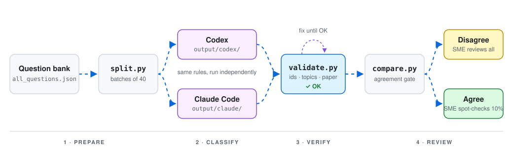

# MRCPsych Question Classifier

Classify MRCPsych theory exam questions against the RCPsych syllabus using coding agents
(Codex, Claude Code) instead of custom ML code. Each question gets a syllabus `topic_id`, its
exam paper (A or B), a cognitive intent, a confidence score and a one-line rationale.
Every result is checked by script, and questions the agents disagree on go to a subject-matter
expert (SME) for review.

<p align="center">
  
</p>

## Why this design

- **Rules live in plain files.** The syllabus taxonomy, boundary rules and examples are
  Markdown. Domain experts can read and correct them without touching code.
- **Small batches.** Agents drift on long runs. Questions are processed 40 at a time, one
  output file per input file.
- **Validation by code, not trust.** After each batch the agent must run `validate.py` and fix
  every error before moving on.
- **Agreement gate.** Two independent runs are compared. Agreement suggests a correct label;
  disagreement goes to an SME. A 10% sample of agreed items is spot-checked as well, because
  two models can be confidently wrong together.
- **Nothing is wasted.** The refined rules files become the system prompt for a production
  API pipeline later, and SME-reviewed results become a golden test set.

## Syllabus coverage

Source: [RCPsych MRCPsych Examination Syllabus](https://www.rcpsych.ac.uk/training/exams/preparing-for-exams/mrcpsych-examination-syllabus),
the version that applies to theory exams from **January 2027**.

| Paper | Sections |
|---|---|
| A | 1 Psychology and Human Development · 2 Neuroscience · 3 Clinical Psychopharmacology · 4 Classification and Assessment |
| B | 5 Services · 6 General Adult · 7 Old Age · 8 Psychotherapy · 9 Child and Adolescent · 10 Addictions · 11 Forensic · 12 Intellectual Disability · 13 Research Methods, Statistics and Critical Review |

There are **131 topic IDs**. Each ID is a syllabus subsection (e.g. `3.3` Pharmacodynamics). The
three disorder subsections that would otherwise hold many disorders are split per disorder:
`6.1.x` (adults), `7.5.x` (older people) and `9.7.x` (children and adolescents).

## Project structure

```
AGENTS.md                 Agent instructions: process, output schema, validation step
CLAUDE.md                 Points Claude Code at AGENTS.md
rules/
  syllabus.md             Taxonomy: topic_id, paper, title, covered items
  boundary-rules.md       Tie-breakers for overlapping topics (draft, SME to refine)
  examples.md             Worked examples (draft)
input/                    batch_NNN.json, created by split.py
output/
  codex/                  batch_NNN.result.json from Codex
  claude/                 batch_NNN.result.json from Claude Code
review/
  disagreements.csv       Items where the agents chose different topics
  spot_check.csv          Random 10% of agreed items
scripts/
  split.py                Split the question bank into batches
  validate.py             Check one result file
  compare.py              Compare the two agents and write review files
  test_validate.py        Self-check for validate.py
docs/pipeline.svg         Diagram above
```

## Requirements

- Python 3.9 or later (standard library only, nothing to install)
- [Codex CLI](https://github.com/openai/codex) and/or [Claude Code](https://claude.com/claude-code), signed in

## Quick start

**1. Prepare the input.** Put your questions in one JSON array. `question_id` is required and
must be unique. Put the question text in `stem`, `question` or `text` so it appears in the
review files. Other fields are copied through unchanged.

```json
[
  {
    "question_id": "q_0001",
    "stem": "Clozapine is primarily metabolised by which cytochrome P450 enzyme?",
    "options": ["CYP1A2", "CYP2D6", "CYP3A4", "CYP2C19", "CYP2E1"],
    "answer": "CYP1A2"
  }
]
```

**2. Split into batches.**

```bash
python scripts/split.py all_questions.json
```

This writes `input/batch_001.json`, `input/batch_002.json`, … with 40 questions each. Use
`--size 25` (anything from 25 to 50) to change the batch size. The script stops without writing
anything if an item is missing a `question_id` or an ID is duplicated.

**3. Classify.** Run each agent with its own name so their results stay separate.

```bash
codex exec --full-auto "You are agent 'codex'. Follow AGENTS.md for every file in input/."
```

```bash
claude -p "You are agent 'claude'. Follow AGENTS.md for every file in input/."
```

Each agent reads the rules, classifies one batch at a time, writes
`output/<agent>/batch_NNN.result.json`, and runs `validate.py` until the file passes.

**4. Compare and review.**

```bash
python scripts/compare.py
```

This prints the agreement rate and writes `review/disagreements.csv` and
`review/spot_check.csv`. Both open in Excel and include empty `sme_topic_id` and `sme_note`
columns for the reviewer.

## Output schema

One object per input question, in input order:

```json
{
  "question_id": "q_0001",
  "topic_id": "3.2",
  "paper": "A",
  "cognitive_intent": "knowledge",
  "confidence": 0.95,
  "rationale": "CYP450 metabolism of clozapine is pharmacokinetics."
}
```

| Field | Rule |
|---|---|
| `question_id` | Copied exactly from the input |
| `topic_id` | Must exist in `rules/syllabus.md` |
| `paper` | `A` or `B`, must match the topic's paper |
| `cognitive_intent` | `knowledge` (recall, mechanism, calculation) or `clinical_application` (vignette asking diagnosis or management) |
| `confidence` | 0 to 1; below 0.7 means unsure, with the alternative topic named in the rationale |
| `rationale` | One short sentence |

## Validation

```bash
python scripts/validate.py output/codex/batch_001.result.json
```

Prints `OK`, or lists every problem and exits with code 1. It checks that:

- every input question appears exactly once, in input order, with no extra IDs
- every `topic_id` exists in the syllabus table
- `paper` matches the paper of that topic
- `cognitive_intent`, `confidence` and `rationale` are valid
- each object has exactly the six schema fields

Run the self-check after changing the validator or the syllabus file:

```bash
python scripts/test_validate.py
```

## Using one agent only

The setup works with Codex alone. You lose the cross-agent agreement gate, since
`compare.py` currently compares `output/claude/` with `output/codex/`. To keep a review queue
with one agent, either:

- run Codex twice under two agent names (ideally with a different model or reasoning level)
  and compare the two runs, or
- send every item with confidence below 0.7, plus a random sample of the rest, to SME review.

## Improving accuracy

Most of the accuracy comes from `rules/boundary-rules.md` and `rules/examples.md`.

1. Review `disagreements.csv` and fill in `sme_topic_id`.
2. Look for patterns: the same pair of topics being confused again and again.
3. Add or sharpen a boundary rule for that pair, and add a real question as an example.
4. Re-run on a sample of affected batches and compare the agreement rate.

## Notes

- Re-splitting overwrites batch files with the same names but leaves old extra ones. Empty
  `input/` and both `output/` folders before splitting a different question set, because
  agents skip batches that already have a valid result.
- CASC questions and leaf-level syllabus IDs are not covered.
